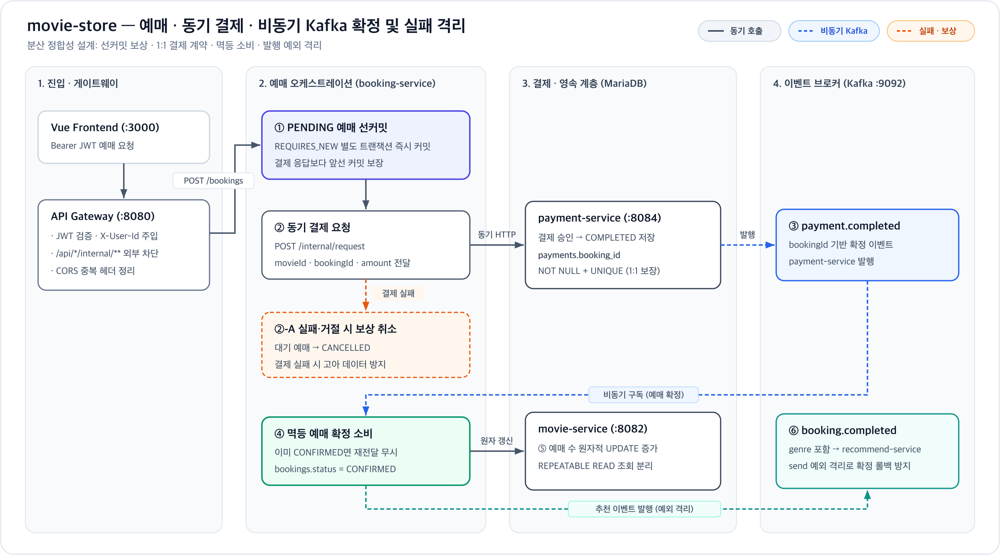

# movie-store

영화 예매 MSA 데모 플랫폼. KOBIS 박스오피스와 TMDB 메타데이터를 수집해 홈화면에 뿌리고, 예매하면 결제·확정까지 이벤트 체인으로 이어진다.

> The following practice code is intended for educational purposes only. For contact : audit@korea.ac.kr, Sungryel Lim Ph.D
>
> This practice code is not a completed commercial version but has been developed for educational purposes; supplementation is required depending on the deployment objective for use as a commercial service.

---

## 담당 범위 및 핵심 정합성 설계

Spring Boot 기반 강의 수강신청 MSA 템플릿을 영화 예매 플랫폼으로 전환하는 팀 프로젝트에서 **`movie-service`, `booking-service`, `payment-service`, `api-gateway`의 도메인 재설계와 프론트엔드 API 연동**을 담당했다 (`recommend-service` 및 화면은 팀원 담당).



| 설계 항목 | 문제 배경 | 적용한 해결 방식 |
|---|---|---|
| **재예매 1:1 결제 계약** | 기존 `(user_id, course_id)` 복합 유니크로는 동일 영화 재예매 시 결제 대상이 엇갈림 | `bookings` 복합 유니크 제거 후 `payments.booking_id`에 `NOT NULL + UNIQUE` 부여 |
| **동기·비동기 역전 방지** | 결제가 빠르면 `payment.completed`가 예매 저장 커밋보다 먼저 도착해 확정 실패 | `PENDING` 예매를 `REQUIRES_NEW`로 선커밋 후 결제 호출, 실패 시 `CANCELLED` 보상 취소 |
| **멱등 확정 및 발행 격리** | 중복 이벤트나 `KafkaTemplate.send` 동기 예외가 결제된 예매까지 롤백시킬 위험 | `CONFIRMED` 재전달 무시, `booking_count` 원자적 `UPDATE`, 추천 이벤트 발행 예외 격리 |
| **MVCC 스냅샷 가시성** | `getBoxoffice()` 최초 수집 시 외곽 `readOnly` 트랜잭션의 MariaDB `REPEATABLE READ` 스냅샷 고정으로 신규 영화 누락 | 조회 진입 메서드에 `NOT_SUPPORTED` 전파 분리로 최신 커밋본 조회 |
| **게이트웨이 경계 제어** | 내부 API 외부 노출 및 게이트웨이·하위 서비스 간 CORS 헤더 중복 삽입 | `/api/*/internal/**` 외부 차단(`denyAll`) 및 `DedupeResponseHeader` 설정 |

> 동시 200건 요청 부하 실험에서 확인한 HikariCP `REQUIRES_NEW` 커넥션 풀 교착 해소(`NOT_SUPPORTED`) 및 컨슈머 재시도·DLT(`payment.completed.DLT`) 격리 실험은 [`feat/booking-service-api`](https://github.com/LeeJung-Heon/movie-store/tree/feat/booking-service-api) 브랜치에 정리되어 있다.

---

## 시스템 구성

```
                        [Vue Frontend :3000]
                                 │  Bearer JWT
                                 ▼
                      [API Gateway :8080]
                   JWT 검증 → X-User-Id 헤더 주입
                     Eureka 로 서비스 탐색
                                 │
     ┌───────────┬───────────────┼───────────────┬───────────────┐
     ▼           ▼               ▼               ▼               ▼
[user :8081] [movie :8082] [booking :8083] [payment :8084] [recommend :8085]
     │           │               │               │
     │           │  KOBIS +      │               │
     │           │  TMDB 수집     │               │
     └───────────┴──[MariaDB lecture_db :3379]───┘
                                 │
                        [Kafka :9092]
                  payment.completed / booking.completed
                                 │
                    [Eureka :8761]  [Auth Server :9000]
```

| 서비스 | 컨테이너 | 포트 | 빌드 |
|---|---|---|---|
| API Gateway | `lecture-gateway` | 8080 | 소스 빌드 |
| User Service | `lecture-user` | 8081 | 소스 빌드 |
| Movie Service | `lecture-movie` | 8082 | 소스 빌드 |
| Booking Service | `lecture-booking` | 8083 | 소스 빌드 |
| Payment Service | `lecture-payment` | 8084 | 소스 빌드 |
| Recommend Service (FastAPI) | `lecture-recommend` | 8085 | 소스 빌드 |
| Eureka Server | `lecture-eureka` | 8761 | 소스 빌드 |
| **Auth Server** | `lecture-auth` | 9000 | **사전 빌드 이미지** |
| MariaDB | `lecturedb` | 3379 → 3306 | 공식 이미지 |
| Kafka (KRaft) | `lecture-kafka` | 9092 | 공식 이미지 |
| Frontend | `lecture-frontend` | 3000 → 80 | 소스 빌드 |

`auth-server`만 저장소에 소스가 없다. 나머지는 전부 소스에서 빌드된다.

---

## 데이터 모델

```
users ──┬─< bookings >─── movies ──< boxoffice_rankings
        │       │            │
        └─────< payments >───┘
```

| 테이블 | 설명 |
|---|---|
| `users` | 회원 |
| `movies` | KOBIS 영화코드(`movie_cd`) 기준 캐시. TMDB에서 장르·포스터·줄거리 보강 |
| `boxoffice_rankings` | 일간/주간 순위 스냅샷. `UNIQUE(rank_type, target_date, rank_no)` |
| `bookings` | 예매. **같은 영화를 여러 번 예매할 수 있어 `UNIQUE(user_id, movie_id)`가 없다** |
| `payments` | 결제. `booking_id`가 NOT NULL + UNIQUE — 예매 1건당 결제 1건 |

`payments.booking_id`가 이 설계의 핵심이다. 구 강의 플랫폼은 `UNIQUE(user_id, course_id)` 덕분에 결제를 `(userId, courseId)`로 특정할 수 있었지만, 영화는 재예매가 가능해 그 제약을 없앴다. `booking_id` 없이는 같은 영화를 두 번 예매했을 때 두 번째 결제가 첫 번째 예매를 확정시킨다.

---

## 시작하기

### 1. API 키 준비

`movie-service`가 KOBIS와 TMDB를 호출한다. 프로젝트 루트에 `.env`를 만든다 (`.gitignore` 대상이라 커밋되지 않는다).

```bash
cat > .env <<'EOF'
KOBIS_API_KEY=발급받은_KOBIS_키
TMDB_API_KEY=발급받은_TMDB_키
EOF
```

- KOBIS: https://www.kobis.or.kr/kobisopenapi/
- TMDB: https://www.themoviedb.org/settings/api

키가 없어도 스택은 뜬다. 박스오피스 조회 시점에만 실패한다.

### 2. Auth Server 이미지 로드

```bash
docker load -i infra-images.tar
docker images | grep msa-lecture   # msa-lecture/auth-server:1.0 확인
```

### 3. 기동

```bash
docker compose up -d --build
```

> **⚠️ 기존 볼륨이 있다면 반드시 `docker compose down -v` 를 먼저 실행할 것**
>
> `ddl-auto: update` 는 컬럼을 **추가만 하고 지우지 않는다.** 구 도메인(강의) 시절의 볼륨을 그대로 쓰면 `payments` 테이블에 `course_id BIGINT NOT NULL` 이 남아 있어 결제 insert 가 다음 오류로 실패한다.
>
> ```
> Field 'course_id' doesn't have a default value
> ```
>
> 이미 그 상태라면: `docker exec lecturedb mariadb -umanager -pSqlDba-1 lecture_db -e "ALTER TABLE payments DROP COLUMN course_id;"`

기동 순서는 `depends_on` 으로 강제된다:

```
MariaDB / Kafka → Eureka → Auth Server → Gateway + 서비스들 → Recommend → Frontend
```

### 4. 확인

```bash
docker compose ps                 # 전체 상태
open http://localhost:8761        # Eureka 등록 현황
curl http://localhost:8080/actuator/health
```

---

## 동작 확인

게이트웨이(8080)를 거치는 대부분의 경로는 JWT 가 필요하다. 토큰 없이 확인하려면 서비스 포트로 직접 호출한다.

```bash
# 박스오피스 수집 (첫 호출에서 KOBIS + TMDB 를 실제로 호출한다)
curl -s "http://localhost:8082/api/movies/boxoffice?type=DAILY" | jq

# 회원 생성 — bookings.user_id 가 FK 라 사용자가 먼저 있어야 한다
curl -s -X POST http://localhost:8081/api/users/register \
  -H 'Content-Type: application/json' \
  -d '{"name":"테스트","email":"test@example.com","password":"password123","role":"STUDENT"}'

# 예매 — movies.id 는 수집할 때마다 새로 발번되므로 실제 값을 조회해서 쓴다
MID=$(docker exec lecturedb mariadb -umanager -pSqlDba-1 lecture_db -N \
  -e "SELECT id FROM movies ORDER BY id LIMIT 1;" | tr -d '[:space:]')
UID_=$(docker exec lecturedb mariadb -umanager -pSqlDba-1 lecture_db -N \
  -e "SELECT id FROM users LIMIT 1;" | tr -d '[:space:]')

curl -s -X POST http://localhost:8083/api/bookings \
  -H 'Content-Type: application/json' -H "X-User-Id: $UID_" \
  -d "{\"movieId\": $MID, \"quantity\": 2}"

# 결과 확인 — CONFIRMED / COMPLETED 가 되어야 정상
docker exec lecturedb mariadb -umanager -pSqlDba-1 lecture_db -e \
  "SELECT b.id, b.status, p.status AS payment, m.booking_count
   FROM bookings b LEFT JOIN payments p ON p.booking_id=b.id
   LEFT JOIN movies m ON m.id=b.movie_id ORDER BY b.id DESC LIMIT 3;"
```

---

## 주요 흐름

### 박스오피스 (lazy 캐시)

```
GET /api/movies/boxoffice?type=DAILY|WEEKLY
  └ boxoffice_rankings 에 해당 기준일 스냅샷이 있으면 그대로 반환 (오픈API 호출 없음)
    └ 없으면 KOBIS 조회 → movies upsert → TMDB 보강 → 스냅샷 저장
```

- `targetDt` 는 항상 집계가 끝난 과거 날짜다. 일간은 어제, 주간은 직전 일요일.
- TMDB 보강은 `tmdb_id` 가 아직 없는 영화에만 1회 수행한다. 같은 영화가 며칠간 순위에 머물러도 TMDB 호출은 영화당 한 번이다.
- KOBIS 는 장르를 주지 않아 TMDB 가 필수다. 음식 추천이 장르에 의존한다.

### 예매

```
POST /api/bookings { movieId, quantity }
  1) movie-service : 영화 존재 확인 + 티켓 단가 조회
  2) bookings INSERT (PENDING, amount = price × quantity) — 별도 트랜잭션으로 즉시 커밋
  3) payment-service : /internal/request { userId, bookingId, movieId, amount }
  4) payments INSERT → 모의 승인 → COMPLETED
  5) Kafka  payment.completed { paymentId, bookingId, userId, movieId }
  6) booking-service 소비 → bookings.status = CONFIRMED
                          → movies.booking_count 원자적 증가
  7) Kafka  booking.completed { bookingId, userId, movieId, genre }
```

2번이 별도 트랜잭션인 이유: 결제가 빠르면 `payment.completed` 가 바깥 트랜잭션 커밋보다 먼저 도착할 수 있고, 그때 booking 행이 없으면 확정에 실패한다.

결제 요청이 실패하거나 거절되면 PENDING 예매는 자동으로 CANCELLED 된다.

---

## Kafka 토픽

| 토픽 | 발행 | 소비 | 페이로드 |
|---|---|---|---|
| `payment.completed` | payment-service | booking-service | `paymentId, bookingId, userId, movieId, status` |
| `booking.completed` | booking-service | recommend-service | `bookingId, userId, movieId, genre` |

---

## 인증

```
1. 프론트 → GET /oauth2/authorize (client_id, redirect_uri, scope)
2. auth-server 로그인 폼 → 로그인
3. 302 → {redirect_uri}/callback?code=...
4. 프론트 → POST /oauth2/token (Basic web-client:web-secret, grant_type=authorization_code)
5. access_token(JWT) 수신
6. 이후 요청에 Bearer 토큰 → Gateway 가 검증 후 X-User-Id / X-User-Email / X-User-Role 주입
```

각 서비스는 자체 인증 로직 없이 `@RequestHeader("X-User-Id")` 로 사용자를 식별한다. 게이트웨이는 이 헤더들을 **덮어쓴다** — 클라이언트가 직접 보낸 값은 무시된다.

게이트웨이 공개 경로: `/oauth2/**`, `/login`, `/logout`, `/actuator/**`, `/api-docs/**`, `/swagger-ui/**`, `/api/users/register`, `/api/users/login`

---

## 로그

```bash
docker compose logs -f                      # 전체
docker compose logs -f movie-service        # 개별
```

서비스명: `mariadb` `kafka` `eureka-server` `auth-server` `api-gateway` `user-service` `movie-service` `booking-service` `payment-service` `recommend-service` `frontend-web`

---

## 프론트엔드

컨테이너로 이미 3000 포트에 뜬다. 로컬에서 직접 돌리려면:

```bash
cd vue-frontend
npm install
npm run dev
```

브라우저: http://localhost:3000

---

## 종료

```bash
docker compose down        # 컨테이너만
docker compose down -v     # 볼륨(DB 데이터)까지 — 스키마가 바뀐 뒤에는 이쪽
```

---

## 트러블슈팅

**컨테이너 이름 충돌** (`The container name "/lecture-kafka" is already in use`)
다른 compose 프로젝트가 같은 `container_name` 을 쓰고 있다. 정지된 잔여 컨테이너를 지운다:
```bash
docker rm lecture-kafka lecture-eureka lecture-auth   # 필요한 것만
```

**빌드 중 `429 Too Many Requests`**
Maven Central 이 rate limit 을 건 상태다. 각 모듈의 `build.gradle` 과 `settings.gradle` 에 Google 이 운영하는 Maven Central 공식 미러가 이미 설정되어 있으므로 대개 그대로 통과한다. 그래도 실패하면 잠시 후 재시도한다.

**박스오피스가 비어 있음**
`.env` 의 `KOBIS_API_KEY` / `TMDB_API_KEY` 를 확인한다. `movies` 에 행은 있는데 `genre` 가 전부 `OTHER` 면 TMDB 키 문제이거나 제목 매칭 실패다:
```bash
docker compose logs movie-service | grep TmdbClient
```

**예매가 PENDING 에서 멈춤**
`payment.completed` 가 도착하지 않은 것이다. Kafka 와 payment-service 로그를 본다:
```bash
docker compose logs payment-service | grep "payment.completed"
docker compose logs booking-service | grep -E "payment.completed|예매 확정"
```
